<div align="center">


# Bench

### The ECE 3143 MES lab manual, running in your browser

An LPC1768 trainer board, an embedded-C compiler and an ARM7 assembler, all running client-side.
Every program from the manual, a worked solution to every exercise, and a board you wire by hand.

<br />


<br />

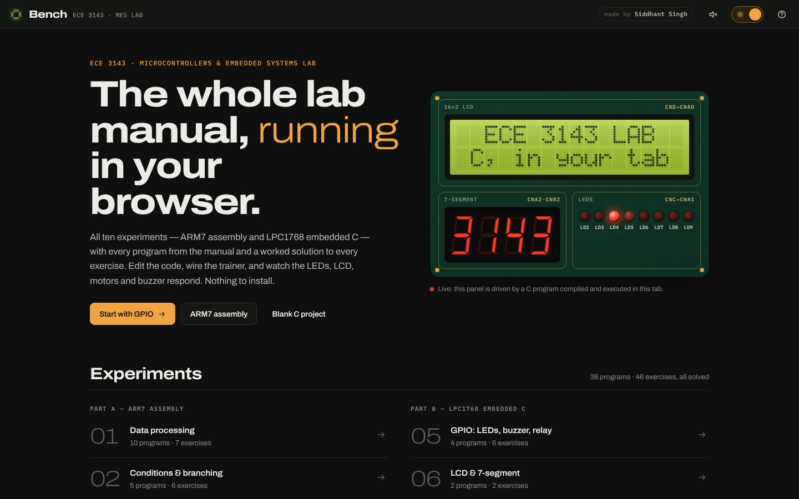

</div>

---

## Contents

- [What it is](#-what-it-is)
- [Screenshots](#-screenshots)
- [Features](#-features)
- [Experiments covered](#-experiments-covered)
- [How it works](#-how-it-works)
- [The board and its wiring](#-the-board-and-its-wiring)
- [Run it locally](#-run-it-locally)
- [Deploy](#-deploy)
- [Testing](#-testing)
- [Project layout](#-project-layout)
- [Fidelity and limitations](#-fidelity-and-limitations)

---

## 🧭 What it is

Bench is a study companion for the **Microcontrollers & Embedded Systems lab (ECE 3143)**. It covers all ten
experiments, ARM7 assembly in Part A and LPC1768 embedded C in Part B, with the manual's programs, a solution
to every exercise question, and a simulated **ALS-SDA-ARMCTXM3-01** trainer board beside the code.

> [!TIP]
> Everything (compiling, assembling and simulating) runs in the visitor's browser. There is no server, no
> account and nothing to install, and after the first visit it works offline.

---

## 📸 Screenshots

<table>
  <tr>
    <td width="50%">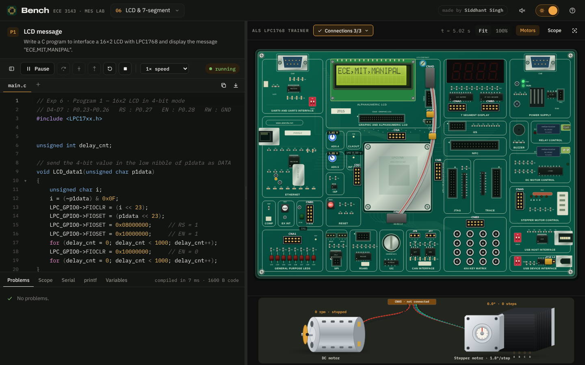<br /><sub><b>Exp 6 · LCD</b> - the manual's 4-bit LCD driver writing <code>ECE,MIT,MANIPAL</code></sub></td>
    <td width="50%">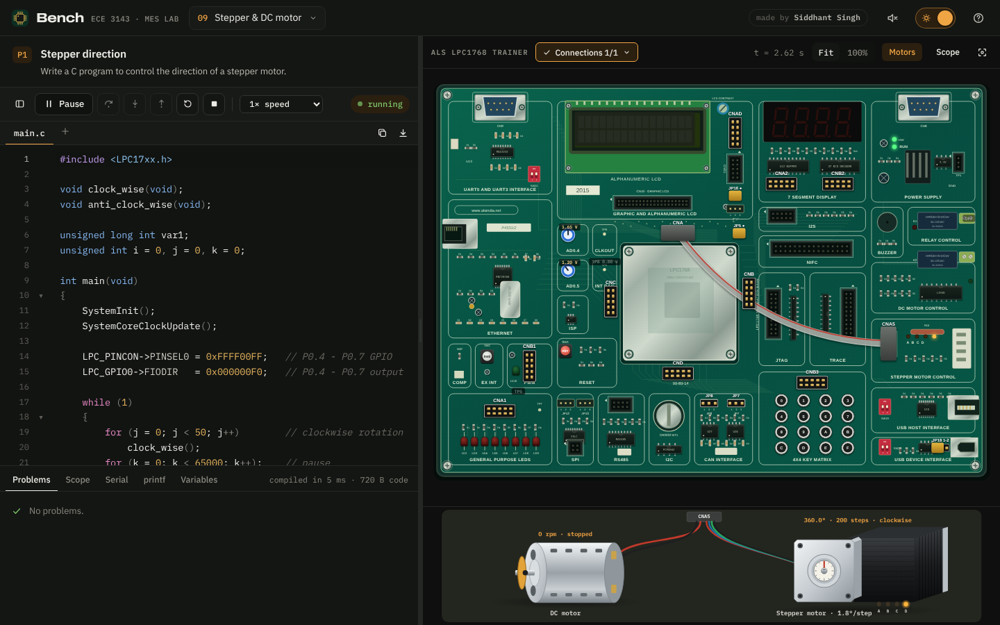<br /><sub><b>Exp 9 · Stepper</b> - 200 steps = 360°, motors wired to CNA5 below the board</sub></td>
  </tr>
  <tr>
    <td width="50%">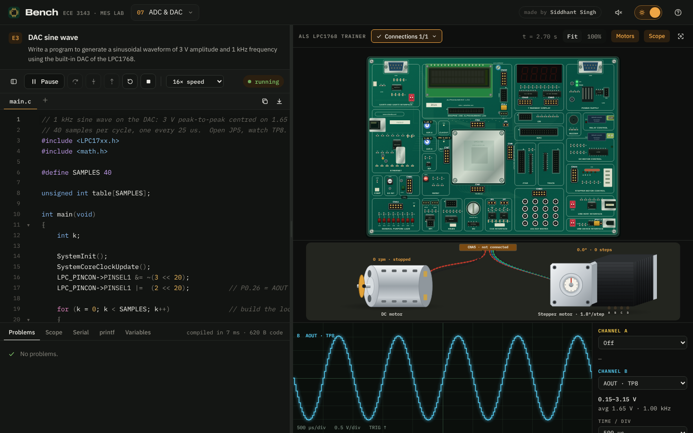<br /><sub><b>Exp 7 · DAC sine</b> - 1.00 kHz, 0.15-3.15 V on the on-board oscilloscope</sub></td>
    <td width="50%">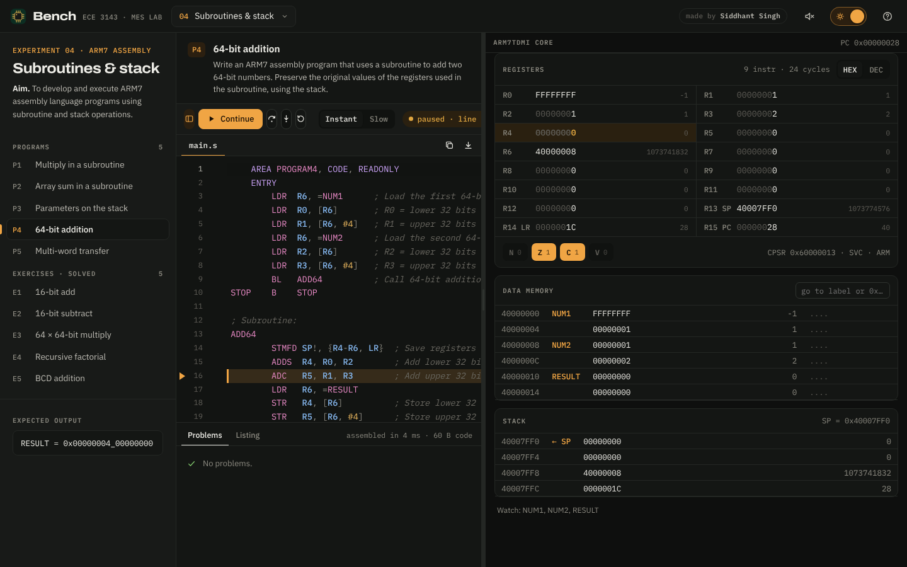<br /><sub><b>Exp 4 · ARM7</b> - stepping a subroutine with registers, flags and the stack</sub></td>
  </tr>
  <tr>
    <td width="50%">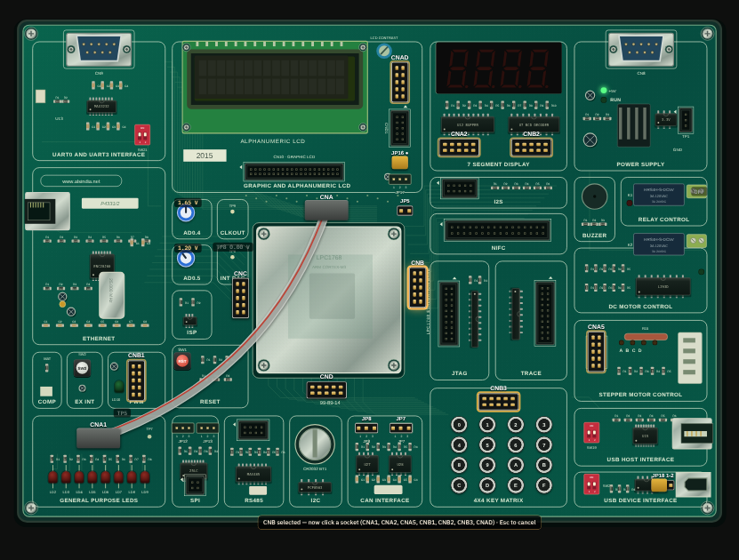<br /><sub><b>Manual wiring</b> - click a header, then a socket, to plug a ribbon cable</sub></td>
    <td width="50%" align="center">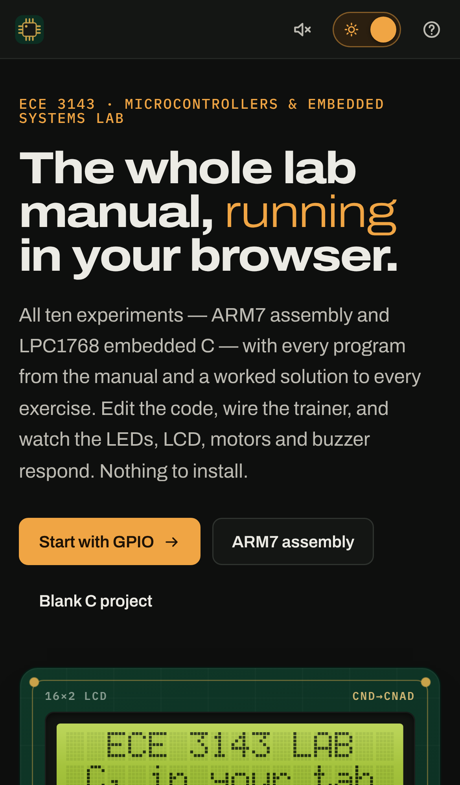<br /><sub><b>Phones</b> - Manual · Code · Board tabs</sub></td>
  </tr>
</table>

---

## ✨ Features

| | Feature | Details |
|:-:|---|---|
| 🧩 | **Embedded-C compiler** | Preprocessor, parser and bytecode VM for the lab subset: structs, unions, pointers, arrays, `switch`, interrupts, `sprintf`, multi-file projects with headers. Uses the CMSIS `LPC17xx.h` register layout. |
| 🦾 | **ARM7 assembler + CPU** | Keil syntax (`AREA`, `ENTRY`, `EQU`, `DCD/DCW/DCB`, `SPACE`, literal pools, `LDR Rx,=value`), conditional execution, barrel shifter, `LDM/STM`, `UMULL/SMLAL`. Shows a listing with machine code. |
| 🟩 | **The real board** | Built on the ALS board artwork, with live LEDs, 16×2 LCD, 4-digit 7-segment display, 4×4 key matrix, SW2/EINT2, RST, buzzer, relay and pots at their real positions. |
| 🔌 | **Manual wiring** | Plug FRC cables from any header (CNA-CND) into any socket by clicking; click a cable to unplug it. Jumpers JP5, JP7, JP8, JP16 and JP18 toggle by click. A live checklist shows what the manual's *Connections* still need. |
| ⚙️ | **3D motors** | The stepper (1.8°/step) and DC motor sit below the board, wired to CNA5, and turn exactly as the code drives them. |
| 📈 | **Oscilloscope** | Two channels with trigger, frequency, duty-cycle and voltage readings. Opens under the board for the waveform questions (PWM, DAC). |
| 🐞 | **Debugger** | Breakpoints, step over/into/out, live variables, plain-language errors pointing at the line, and runtime faults such as bad pointers or divide by zero. |
| 🔊 | **Sound** | Buzzer tones, relay clicks, a faint motor hum, and a "listen to channel A" probe speaker. |
| 📴 | **Offline + installable** | A service worker caches the whole app on the first visit; it can be installed like an app. |
| 🌗 | **Dark by default** | Copper and amber light/dark themes, a responsive layout from phone to desktop, and keyboard shortcuts (<kbd>?</kbd>). |

---

## 📚 Experiments covered

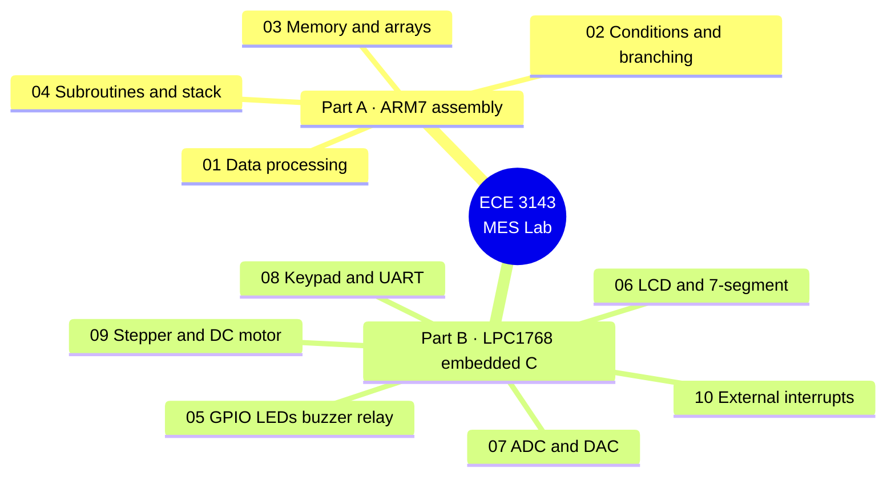

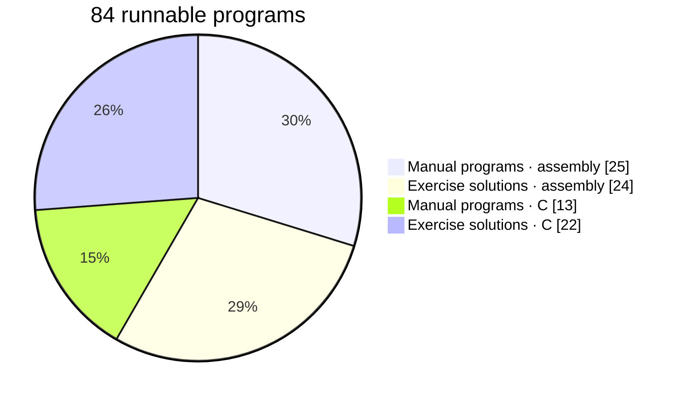

<details>
<summary><b>Full list of programs and exercises</b></summary>

| Exp | Topic | Programs | Exercises |
|:-:|---|:-:|:-:|
| 1 | Data processing: ADD, SUB, MUL, MLA, logic, shifts, rotates | 10 | 7 |
| 2 | Conditional execution and branching: sign, parity, GCD, sum of N | 5 | 6 |
| 3 | Memory and arrays: tables, search, string length, character count | 5 | 6 |
| 4 | Subroutines and stack: 64-bit add, stack parameters, multi-word transfer | 5 | 5 |
| 5 | GPIO: LEDs, buzzer, relay, square wave | 4 | 6 |
| 6 | LCD (4-bit HD44780) and multiplexed 7-segment | 2 | 2 |
| 7 | ADC to LCD, DAC ramp, square and sine waves | 2 | 3 |
| 8 | 1×4 key matrix, UART3 echo, LCD/7-seg/serial combinations | 2 | 5 |
| 9 | Stepper direction, DC motor direction and speed | 2 | 2 |
| 10 | EINT2: LED toggle, motor sequencing and speed | 1 | 4 |

</details>

---

## 🏗️ How it works

### Architecture

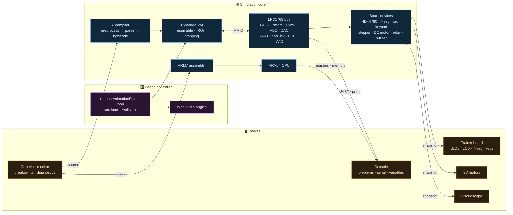

### The C toolchain

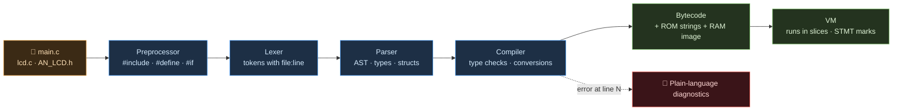

### One animation frame

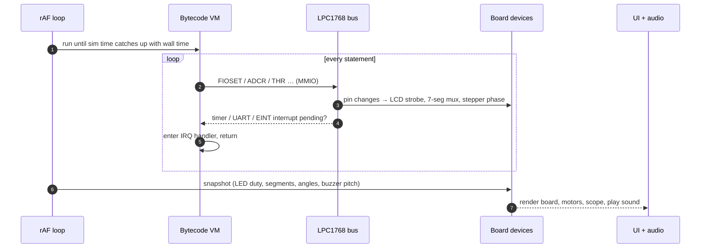

### Run states

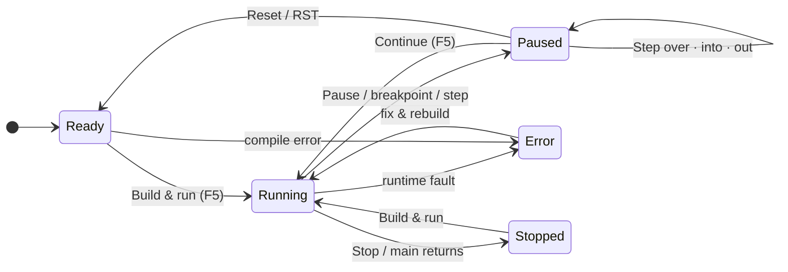

---

## 🔌 The board and its wiring

Ribbon cables join an **MCU header** to a **peripheral socket**. Any header can feed any socket, and the
simulator follows the actual pins. CNC → CNA1, for example, drives the LEDs from P0.15-P0.22.

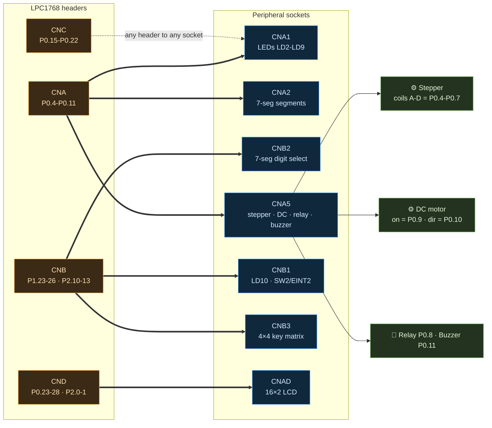

| Jumper | Shorted means | Needed for |
|:-:|---|---|
| **JP5** | P0.26 drives LCD D7 | LCD programs (open it for the DAC) |
| **JP16** | LCD powered | every LCD program |
| **JP18 (2-3)** | POT4 → AD0.4 / P1.30 | ADC programs |
| **JP7 / JP8** | UART3 TX / RX → RS-232 port | serial programs |

---

## 🚀 Run it locally

> [!NOTE]
> Requires **Node.js 18+**.

```bash
npm install
npm run dev        # http://localhost:5173
npm test           # unit tests: every manual program and exercise on the simulator
npm run build      # production build into dist/
```

---

## ☁️ Deploy

The site is **frontend only**: a static bundle of HTML, CSS and JavaScript. All asset paths are
relative and routing uses URL hashes, so any static host works with no rewrite rules.

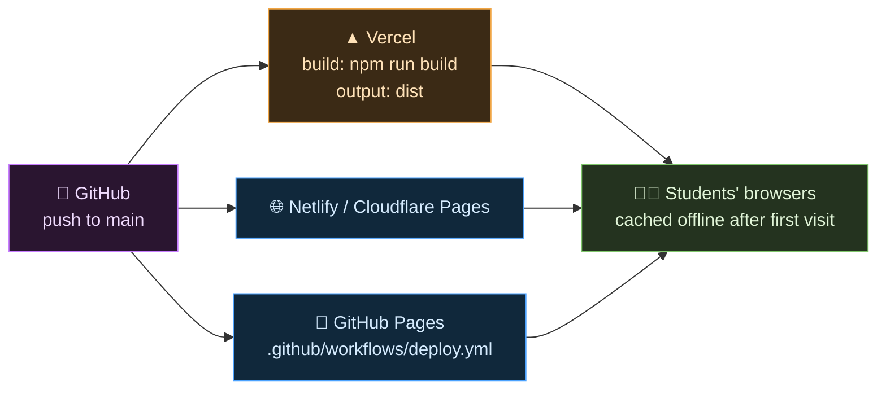

| Host | Steps |
|---|---|
| **Vercel** *(recommended)* | Import the repo → framework **Vite** → build `npm run build` → output `dist` → Deploy |
| **Netlify** | New site from Git → build `npm run build` → publish `dist` |
| **Cloudflare Pages** | Connect to Git → preset **Vite** → output `dist` |
| **GitHub Pages** | Settings → Pages → Source: **GitHub Actions**, then push to `main` |

> [!IMPORTANT]
> Students' code edits and their cable wiring are saved in their own browser (`localStorage`). Nothing is
> sent anywhere.

---

## 🧪 Testing

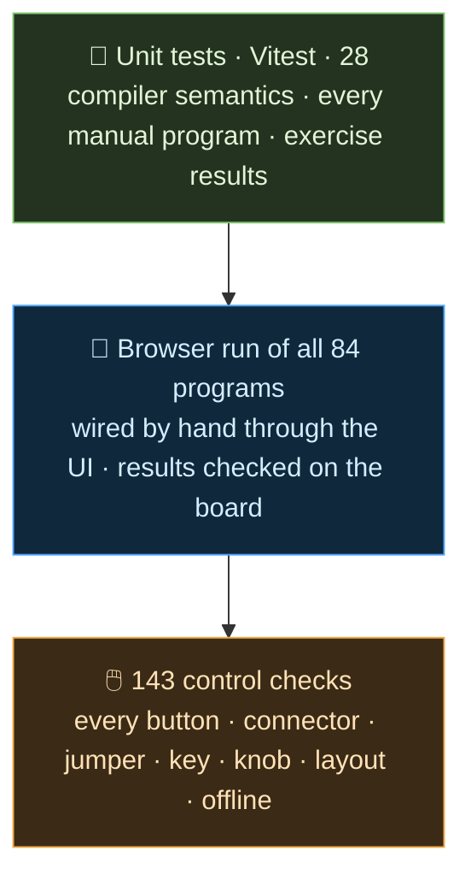

```bash
npm test                                  # unit tests
npm run build && npx vite preview --port 4173
node tests/e2e/e2e_programs.cjs           # run all 84 programs in the browser
node tests/e2e/e2e_ui.cjs                 # click every control
```

---

## 🗂️ Project layout

```text
src/
├── content/
│   ├── experiments.ts      aims, algorithms, connections, notes for all 10 experiments
│   └── code/               every manual program (.c / .s); ex/ holds the exercise solutions
├── sim/
│   ├── c/                  preprocessor · lexer · parser · compiler · bytecode VM · builtins
│   ├── arm/                ARM7 assembler and CPU
│   └── board/              LPC1768 peripherals · wiring model · HD44780 LCD · 5×7 font
├── bench/                  run loop controller · audio · router · storage
├── ui/                     board · motors · scope · editor · console · pages
└── assets/board.svg        ALS-SDA-ARMCTXM3-01 artwork
tests/
├── sim.test.ts             unit tests
└── e2e/                    browser end-to-end checks
```

---

## ⚖️ Fidelity and limitations

<details>
<summary><b>What is modelled, and what is simplified</b></summary>

- **Timing** is modelled, not cycle-exact. At 1× the virtual CPU runs about 2 million statements per second,
  so the manual's delay loops look the way they do on the bench. Timers, PWM, ADC, DAC and UART run on
  accurate (simulated) time.
- **Not simulated:** Ethernet, USB, CAN, I2C, SPI, RS485, the graphic LCD, RTC, watchdog and DMA.
- **Idealised:** no switch bounce, a forgiving LCD controller, ideal motors (no stall), and the UART baud
  rate is not checked against the PC.
- **C subset:** no function pointers, designated initialisers or struct-by-value arguments.
- **Assembly:** ARM state only, with no Thumb, interrupts or processor modes.
- **Manual fixes:** the printed listings' mistakes (an undeclared `delay_cnt`, an LCD buffer with no room
  for `'\0'`, LCD pins never set as outputs, an uninitialised DAC counter) are corrected, and each fix is
  noted beside its program.

</details>

> [!CAUTION]
> This is an unofficial study resource and is not affiliated with the institute.

---

<div align="center">

<sub>Made with ☕ and a lot of FRC cables by <b>Siddhant Singh</b></sub>

</div>
